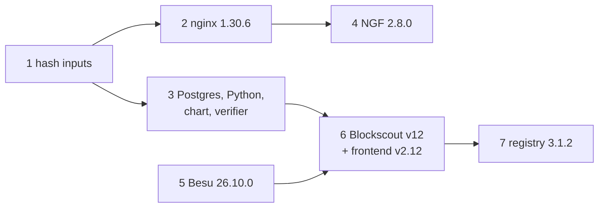

# Image and chart pin refresh — Design

**Status:** Approved (local scope) — 2026-10-21
**Created:** 2026-10-21
**Intent:** [`intent.md`](intent.md)
**Builds on:** `docs/plans/archive/blockscout-v11-upgrade-plan.md` (source-built Blockscout,
greenfield validation), `docs/plans/archive/besu-qbft-osaka-upgrade-plan.md` (Besu baseline
check), `docs/plans/archive/image-build-lifecycle-plan.md` (content-hash image tags). Coordinates
with `docs/plans/sandbox-scripts-and-ci-hardening/` Phases 6 and 9 and with the pending Node
26.12.1 pin bump.

Evidence was gathered on 2026-10-21 against `development` at `f9e9b0a` and the running local
sandbox.

## Decision Summary

- **Fix the cache keys first, then move pins.** A pin bump that a content hash or a running
  container ignores is not deployed. The first slice puts every stage base ref into its image
  hash (nb-ui Node and nginx, nb-bond-api Node, BENS Python) and asserts it. It is split out of
  the Node 26.12.1 branch, whose own pin is blocked upstream today.
- **Seven small PRs, ordered by exposure and risk:** hash inputs → nginx 1.30.6 (security) →
  Blockscout supporting components (Postgres, Python, chart 4.5.3, verifier v1.11.0) → NGINX
  Gateway Fabric 2.8.0 → Besu 26.10.0 → Blockscout backend v12 with frontend v2.12 → registry 3.
- **Blockscout backend and frontend move together.** Frontend v2.11 needs backend ≥ v11.2.8 and
  v2.12 needs backend v12.0.0, so the frontend cannot move alone.
- **Each slice has its own live check.** Images are proven on the running sandbox, not just by
  rendering the charts.
- **Local upgrade only.** Every slice is applied and proven on the local sandbox. The non-local
  rollout comes later. No slice needs a node wipe or a smart-contract redeployment to move
  forward. Two are one-way on existing data: Besu (validator database, reversible with a Besu
  subcommand) and Blockscout v12 (explorer database). `plan.md` "Deferred Non-Local Rollout"
  lists what the later rollout must respect.
- **Licence.** The Blockscout v12 image adds `ffmpeg` (GPL-2.0-or-later AND LGPL-2.1-or-later in
  Alpine). It was approved once and needs a second confirmation before slice 6.

## Current-State Evidence

### Pin inventory

`git grep` on `origin/development`, excluding `docs/plans/archive/`. **Bold** = read at runtime
by the sandbox scripts; the rest are fallbacks, labels, or docs that must still move with the pin.

| Pin | Current → target | Files that name it |
|---|---|---|
| nginx-unprivileged | `1.30.3-alpine` → `1.30.6-alpine` | **`common/images.yaml:55`** (`nb_ui.nginx`), `common/helpers.sh:52` (`NB_UI_NGINX_BASEIMAGE`, fallback only), `services/nb-ui/Dockerfile:19` (`ARG` default; the build always passes `--build-arg`), active plan `docs/plans/nb-ui-correctness-and-hardening/plan.md:426,471` (commands to run against the pin) |
| postgres | `18.4` → `18.6` | **`common/images.yaml:42`**, `services/blockscout/values.yaml:6` (`dbImage` fallback); the image is used by `db-deployment.yaml` and `bens-db-init-job.yaml` |
| python | `3.14.5` → `3.14.8` | **`common/images.yaml:43`**, `common/helpers.sh:41` (`BENS_BASEIMAGE`, unused), `services/blockscout/bens-microservice/Dockerfile:16-17`, `services/blockscout/values.yaml:7` |
| besu | `26.7.1` → `26.10.0` | **`common/images.yaml:31`**, `infra/besu/values.yaml:7`, `scripts/verification/check-besu-qbft-baseline.py:94`, `README.md:56`, `docs/ARCHITECTURE.md:97`, `docs/THIRD_PARTY_NOTES.md:38`, `infra/README.md:49`, `infra/DEVELOPMENT.md:83` |
| Blockscout backend | `v11.2.6` → `v12.0.3` | **`common/images.yaml:40`** (git tag for `build-images.sh`), `services/blockscout/values.yaml:47`, `services/blockscout/debugging.md:139` ("runs a v11 backend") |
| Blockscout frontend | `v2.10.3` → `v2.12.1` | **`common/images.yaml:41`**, `services/blockscout/values.yaml:112` |
| smart-contract-verifier | `v1.10.6` → `v1.11.0` | **`common/images.yaml:48`**, `docs/THIRD_PARTY_NOTES.md:44-45`; env in `services/blockscout/templates/sc-verifier-deployment.yaml` |
| registry | `2.8.3` → `3.1.2` | **`common/images.yaml:57`**, `common/helpers.sh:59` (used only when `yq` is missing) |
| blockscout-stack chart | `4.5.1` → `4.5.3` | **`common/versions.yaml:24`**, `common/helpers.sh:39` (fallback), comment URLs in `services/blockscout/values.yaml:9` and `values.local.yaml:17` |
| NGINX Gateway Fabric chart | `2.6.6` → `2.8.0` | **`common/versions.yaml:25`**, `common/helpers.sh:1118` (literal fallback), `infra/gateway/templates/nodeport-config.yaml:9` (`app.kubernetes.io/version` label); the same version selects the Gateway API CRD ref in `deployApiGateway` (`helpers.sh:1023`) |

Dated evidence rows in active plans (for example
`docs/plans/nb-ui-correctness-and-hardening/design.md:64` and
`docs/plans/sandbox-scripts-and-ci-hardening/design.md:106`) record what was true when they were
written and are left alone. The licence inventory names only Besu and the verifier by version.

### Upstream verification (2026-10-21)

Tags were checked against Docker Hub, ghcr.io, and GitHub releases. Release notes were read in
full for each version step.

| Pin | Newest confirmed | amd64 / arm64 | Security fixes in the step | Breaking changes that reach this repo |
|---|---|---|---|---|
| nginx-unprivileged | `1.30.6-alpine` (stable; mainline is 1.31.7) | yes / yes | 1.30.4: CVE-2026-42533 (`map` + regex), CVE-2026-60005, CVE-2026-56434 (SSI). 1.30.5: CVE-2026-90439 (HTTP/3). 1.30.6: CVE-2026-15176 (`alias` + `rewrite`), CVE-2026-93479 (string expressions with variables, including request logging), CVE-2026-95101 (HTTP/3), CVE-2026-97629 (TLS ticket key rotation), CVE-2026-97205 (AIO + SSI) | None. The image moves from Alpine 3.23 to 3.24 and from njs 0.9.9 to 1.0.2, and the `listen 8080`/uid 101/`/tmp` layout is unchanged. Upstream now names `nginx/nginx-unprivileged` as the Docker Hub home; `nginxinc/` still received `1.30.6-alpine` (2026-10-19) |
| postgres | `18.6` (18.5 was never released: a regression was found after the release was wrapped) | yes / yes | 28 CVEs, including CVE-2026-14662, CVE-2026-14664, CVE-2026-14668 and CVE-2026-6464 | No dump or restore within 18.x. Post-update notes: run `ANALYZE` on tables with GIN indexes (bad `reltuples` estimates); REINDEX btree_gist and ltree indexes (not used here) |
| python | `3.14.8` (3.14.9 was released today and has no image yet) | yes / yes | libexpat 2.8.1 → 2.8.5, tarfile and zipfile fixes, CVE-2026-19445 (ssl), CVE-2026-15806 (urllib) | None for BENS. Both tags use Debian trixie. Since 3.14.8, asyncio refuses TLS with `check_hostname` set and no `server_hostname`; BENS uses plain TCP to its database |
| besu | `26.10.0` | yes / yes | GHSAs fixed in 26.8.0 (including an EIP-7702 consensus split), 26.8.1 (QBFT decode DoS, QBFT withdrawals mint) and 26.9.0 (a non-validator peer can halt QBFT finality). 26.10.0: Bouncy Castle and Jackson CVEs | 26.10.0 **upgrades Bonsai databases one-way on first start**; the validator uses `data-storage-format="BONSAI"`. Default `--discovery-mode` becomes `BOTH`, but both nodes set `discovery-enabled=false`. Genesis already uses `emptyblockperiodseconds` (the `x` key is removed in 26.8.1). `trace_*` answers and tx `"to": null` change. Image is still JDK 25 on Ubuntu 24.04. No fork activates without a genesis key |
| Blockscout backend | `v12.0.3` (source build; ghcr stops at v9) | built locally | v12 only: SSRF hardening for NFT metadata fetches, the `key` leak in `next_page_params`, a node URL leak in `/api/eth-rpc` errors, a verifier version-check bypass | **Major.** Upgrade gate: `min_from: "11.0.2"` and migration `fill_internal_transactions_address_ids` must be `completed`. Heavy automatic schema migrations, no supported downgrade. The Dockerfile path and `BLOCKSCOUT_VERSION`/`RELEASE_VERSION` args are unchanged; the base moves to Elixir 1.20.4 / OTP 28; **adds `ffmpeg`**. API: legacy GET `get-logs`/`eth-block-number` removed, `limit` rejected, ETH-RPC error shape changed |
| Blockscout frontend | `v2.12.1` (source build) | built locally | none called out | v2.11 needs backend ≥ v11.2.8; v2.12 needs backend v12.0.0. Its build stage moves to Node 24 (upstream Dockerfile, not our pin). `NEXT_PUBLIC_TOKEN_ACTION_BUTTON_CONFIG` aborts startup if set (it is not) |
| smart-contract-verifier | `v1.11.0` | yes / yes | Hardening only (#1751, optional compiler isolation) | **New `[compilers.execution]` defaults to `disabled`; compiler-backed endpoints will not start** until `SMART_CONTRACT_VERIFIER__COMPILERS__EXECUTION__TYPE=native` is set (upstream compose uses `native`) |
| blockscout-stack chart | `4.5.3` (no newer chart; no v12-specific chart) | n/a | none | 4.5.2 adds `separateApi.deploymentStrategy` (unused); 4.5.3 changes only Prometheus rules. No key removed. Inferred to work with v12 through the existing image and env overrides |
| NGINX Gateway Fabric | `2.8.0` | yes / yes | 2.6.8: CVE-2026-66362 (NGINX Plus only). 2.8.0: spoofable agent gRPC connection, image CVEs. Data-plane nginx moves 1.31.2 → 1.31.7 (mainline carries the 1.30.4–1.30.6 fixes) | Gateway API CRDs v1.5.1 → v1.6.3 (2.7.0 says to install them before upgrading). Kubernetes ≥ 1.32 from 2.7.0 (the Kind node is v1.32.11). **Helm does not upgrade NGF's own CRDs**, and 2.8.0 adds three. `nginx.org/htpasswd` secrets removed (unused). No Helm value removed |
| registry | `3.1.2` | yes / yes | 2.8.3 is in range of five advisories (CVE-2026-35172, CVE-2026-33540, CVE-2026-41888, CVE-2026-85747, CVE-2026-46595), none fixed in 2.x. With the default config, no proxy and no redis, none is expected to be reachable | Config path moves to `/etc/distribution/config.yml` (none mounted). schema1 removed. `storage.delete.enabled: true` by default, debug server on container `:5001` (not published). Storage layout unchanged |

### Repository evidence

| Finding | Evidence | Consequence |
|---|---|---|
| **Verified.** `bensImageHash` hashes the generated server tree, `requirements.txt` and the `Dockerfile` only | `common/helpers.sh:1556-1569` on `development` | A Python-only bump keeps the old `bens-microservice:<hash>` image |
| **Verified.** On `development`, `nbUIBundleHash` and `nbBondApiBundleHash` also omit their base refs. The pending Node 26.12.1 pin bump adds them and asserts the Node refs only | `common/helpers.sh` `nbUIBundleHash`, `nbBondApiBundleHash` on `development` | Without that change, the nginx 1.30.6 bump does not rebuild nb-ui |
| **Verified.** The nginx and Python refs come from `common/images.yaml` through `getImageValue`, not from the shell constants | `getNBUINginxImage`, `getBensBaseImage` | A hash-sensitivity assertion must point `IMAGES_CONFIG` at a temporary copy; overriding `NB_UI_NGINX_BASEIMAGE` or `BENS_BASEIMAGE` proves nothing |
| **Verified.** `ensureKindRegistry` only `docker start`s an existing `kind-registry` container. `resetKindRegistry` (`registry-reset`) is the only path that recreates it | `common/helpers.sh:499-549, 1465-1472` | A `local_registry` bump is never applied to an existing machine |
| **Verified.** The registry presence and digest checks send `Accept: application/vnd.docker.distribution.manifest.v2+json` only | `registryManifestDigest`, `kindRegistryHasImage` (`helpers.sh:579-617`); the hashed-image path already lists tags because the registry serves OCI manifests (`helpers.sh:1258-1260`) | Must be checked against registry 3 (`Needs verification`); a miss reports "not cached" and re-pushes rather than failing |
| **Verified.** `deployApiGateway` applies the Gateway API CRDs from NGF's repo at `?ref=v<version>` and then runs `helm upgrade --install`; it never applies NGF's own CRDs on upgrade | `helpers.sh:1019-1043` | On an existing cluster, NGF 2.8.0 runs without its three new CRD kinds |
| **Verified.** Blockscout backend and frontend are cloned and built by `services/blockscout/build-images.sh` at the tag in `common/images.yaml`; the registry tag is the version, not a content hash | `build-images.sh` | A version bump needs `./sandbox.sh build-images` before `start` (about 20 minutes) |
| **Verified.** Dependabot has only `npm` and `github-actions` entries | `.github/dependabot.yml` | Why these pins drifted; automation is a follow-up |
| **Verified.** `check-third-party-licenses.py` does not read image pins; `THIRD_PARTY_LICENSES.md` lists components by licence, not version | script, `THIRD_PARTY_LICENSES.md:156-167` | The licence check passes without catching version drift; `docs/THIRD_PARTY_NOTES.md` carries the versions |
| **Verified.** CI path filters: `Besu QBFT Baseline` triggers on `common/images.yaml` and `common/helpers.sh`; `Image Hash Inputs` triggers on `common/helpers.sh` and the BENS dir; `License Inventory` does not trigger on image pins | `.github/workflows/*.yml` | Most slices run the Besu baseline check in CI even when Besu is untouched |

### Runtime evidence (local sandbox, 2026-10-21)

- **Verified:** the running images match the pins: `besu:26.7.1`, Blockscout `v11.2.6`/`v2.10.3`,
  verifier `v1.10.6`, `postgres:18.4`, NGF `2.6.6` (control plane and `nginx:2.6.6` data
  plane), `kind-registry` on `registry:2.8.3`, Kind node `v1.32.11`.
- **Verified:** `nginx -v` in the nb-ui pod prints `nginx/1.30.3`. Through the gateway the
  `Server` header is a bare `nginx` (the gateway hides the version).
- **Verified:** the Kind node publishes `0.0.0.0:80` and `0.0.0.0:8545` (the gateway is
  reachable from the LAN; tracked by the scripts-hardening plan). The registry publishes
  `127.0.0.1:5001` only.
- **Verified:** Gateway API CRDs carry bundle version `v1.5.1`; twelve `gateway.nginx.org` CRDs
  are installed.
- **Verified:** in `blockscout_db`, `fill_internal_transactions_address_ids` is `completed`, and
  the index holds 160 blocks. The v12 upgrade gate is satisfied, and a wipe-and-reindex rollback
  is cheap.
- **Needs verification:** the helpers' catalog, `tags/list` and manifest-digest calls answer
  on `registry:3.1.2` as they do on 2.8.3 (expected; checked in slice 7 Phase 0 against a
  throwaway container before the real registry is touched).
- **Needs verification:** the NGF 2.8.0 data-plane pod labels still match the selector in
  `infra/gateway/templates/nodeport-config.yaml` (`managed-by: ngf-nginx`,
  `name: gateway-nginx`). Upstream still uses the same constants in code.
- **Needs verification:** `forge verify-contract --verifier blockscout` against backend v12. The
  route it uses (`/api?module=contract`) is not among the documented removals.

### nb-ui nginx exposure to the 1.30.4–1.30.6 CVEs

The nb-ui image runs the stock `nginx-unprivileged` configuration. The chart mounts no nginx
config, only `config.js` via `subPath`. That configuration is `listen 8080` (plus `[::]:8080`),
`root /usr/share/nginx/html`, `sendfile on`, plain HTTP, and the default `access_log`. TLS is
not configured anywhere in the sandbox: the gateway listeners are all `protocol: HTTP`.

| CVE | Feature needed | nb-ui | Gateway data plane (NGF 2.6.6, nginx 1.31.2) |
|---|---|---|---|
| CVE-2026-90439, CVE-2026-95101 | HTTP/3 / QUIC | not configured | not configured |
| CVE-2026-97629 | TLS session ticket key rotation | no TLS | no TLS |
| CVE-2026-97205 | AIO + SSI `include virtual` | neither | neither |
| CVE-2026-56434 | SSI on a proxied response | no SSI | no SSI |
| CVE-2026-15176 | `alias` with a `rewrite`-changed URI | neither | generated config (not inspected) |
| CVE-2026-42533, CVE-2026-60005 | `map` + regex captures, `slice` | none | generated config uses `map` (not inspected) |
| CVE-2026-93479 | string expressions with variables, including request logging | **possibly**: the default `log_format main` uses variables (the advisory's trigger detail could not be loaded) | **possibly**: proxy headers and logging use variables |

**Conclusion.** The nb-ui pod is a cluster-internal static file server. The only plausible path
is CVE-2026-93479. For nb-ui, real exposure is low, and the bump is about hygiene and staying on a
patched line. The LAN-reachable nginx is the gateway data plane. That makes NGF 2.8.0 (nginx
1.31.7) the higher-value nginx bump, and the reason slice 4 follows directly after slice 2.

### Existing test coverage and gaps

- `check-besu-qbft-baseline.py` asserts the Besu version constant and the QBFT/Osaka genesis.
- `check-image-hash-inputs.sh` asserts source sensitivity for the three repo-owned images. On
  the pending Node pin bump it also asserts the Node base refs. Nothing yet covers the nginx or Python base
  refs.
- No check compares the duplicated pins (Dockerfile `ARG`s, Helm fallbacks, helper constants,
  the NGF label). That is the scripts-hardening plan's Phase 9, so this plan relies on `git grep`
  sweeps.
- No automated check exercises the explorer after an upgrade. The archived v11 upgrade plan's
  live checklist is the model.

## Significant Findings

| Priority | Finding | Why it matters | Plan response |
|---|---|---|---|
| Blocking | Base refs missing from the image hashes (nb-ui, nb-bond-api, BENS) | The nginx and Python bumps would not deploy | Slice 1, before any base-image bump |
| Blocking | Frontend ≥ v2.11 needs a newer backend | A frontend-only bump breaks the explorer UI | Backend and frontend in one slice |
| Blocking | Verifier v1.11.0 disables compiler execution by default | Contract verification stops working | Add `SMART_CONTRACT_VERIFIER__COMPILERS__EXECUTION__TYPE=native` in the same change |
| Blocking | NGF CRDs are not upgraded by Helm | 2.8.0 on an existing cluster lacks its new CRDs | Apply NGF's `deploy/crds.yaml` at the pinned ref in `deployApiGateway`, server-side |
| Important | Registry container never recreated on a pin change | registry 3 never reaches existing machines | Recreate on mismatch (recommended) or document `registry-reset` (decision D3) |
| Important | Blockscout v12 adds `ffmpeg` (GPL-2.0-or-later AND LGPL-2.1-or-later) to the locally built image | Licence guardrail: more restrictive than Apache-2.0 | Operator double confirmation before slice 6 (decision D4) |
| Important | Besu 26.10.0 upgrades Bonsai databases on first start (only the validator; the archive node is Forest) | 26.7.1 cannot open the upgraded database until `besu storage revert-code-format` runs | Forward upgrade needs no wipe. Rollback runs `revert-code-format`; `./sandbox.sh delete` is the local last resort (D5) |
| Important | 26.8.0 (EIP-7702 consensus split fix) and 26.9.0 (EIP-7610 check removed for every fork) change state-transition rules | Nodes on different versions can disagree on an affected block | Upgrade both nodes in one step; noted for the later non-local rollout |
| Important | `node:26.12.1` currently resolves to an empty image index on Docker Hub | The Node pin bump cannot be verified or merged today | Carve the hash change out of it (slice 1) so the nginx bump does not wait |
| Follow-up | Upstream renamed the Docker Hub home to `nginx/nginx-unprivileged` | `nginxinc/` may stop receiving tags | Stay on `nginxinc/` now; re-check at the next bump |
| Follow-up | The verifier fetches the `linux-amd64` solc list even on arm64 nodes | Pre-existing; out of scope | Report only |

## Invariants

- `common/images.yaml` and `common/versions.yaml` remain the runtime source of truth; every
  duplicate moves in the same commit as its source.
- QBFT with one validator, Osaka from genesis, chain ID 2018, `zeroBaseFee`, the 1 s / 300 s block
  periods, and Forest storage on the archive node all stay as they are.
- Every image stays pinned by explicit tag, never `latest`; both `linux/amd64` and `linux/arm64`
  remain buildable or pullable.
- Repo-owned images rebuild exactly when an input, including a base ref, changes.
- No new listener, port, or public exposure.

## Target Architecture

### Ownership and dependency direction

Nothing changes in who owns what: pins live in `common/`, helpers read them, and charts receive
them through `--set`. The two behavioural changes are both in `common/helpers.sh`:

1. **Hash inputs.** Each `*BundleHash`/`bensImageHash` appends a `base <ref>` line for every
   stage base it builds from, resolved through the same getter the build uses.
   `check-image-hash-inputs.sh` gains `assert_base_ref_sensitivity`. It copies
   `common/images.yaml` into a temporary directory, rewrites one key with `yq`, points
   `IMAGES_CONFIG` at the copy in a subshell, and expects the hash to change. It covers
   `nb_ui.nginx` and `blockscout.bens`; the Node refs keep the variable-override form from the
   pending Node pin bump.
2. **Infrastructure that outlives a pin.**
   - `ensureKindRegistry` compares the running container's image with the pin and recreates the
     container on a mismatch. A recreated registry is empty, so the base images are re-synced, as
     `registry-reset` does.
   - `deployApiGateway` applies NGF's own CRDs at the pinned ref (`kubectl apply --server-side`)
     before `helm upgrade`, the same way it already applies the Gateway API CRDs.

### Consistency and failure semantics

- A bump is deployed only after the operator runs the documented step. The step is
  `registry-sync` plus a component restart for third-party images, `build-images` for
  Blockscout, and nothing extra for repo-owned images, which rebuild on the hash change. Each
  slice's PR says which step.
- Rollback for patch bumps is a revert followed by the same step. Blockscout v12 and Besu 26.10.0
  are one-way on existing data: their rollback includes a data wipe, which the operator approves
  before the slice runs.

### Security and deployment boundary

No exposure change. A non-local deployment that builds its own Blockscout images (see
`docs/KNOWN_ISSUES.md`) has to rebuild at the new tags. The plan records only that portability
note and nothing about any specific environment.

## Alternatives Considered

- **One rollup PR for every pin.** It lost because a failure in Blockscout v12 or registry 3
  would hold back the nginx security fix, and a single revert would undo unrelated bumps.
- **Blockscout v11.3.3 with frontend v2.11.5 as an interim step.** It keeps the v11 schema and
  Node 22, but misses the v12-only SSRF and verifier fixes and leaves a major for later. Use it
  only if decision D4 (ffmpeg) is declined.
- **Leave the registry recreate to a documented `registry-reset`.** That needs no code, but every
  operator has to read the release note. An automatic recreate costs about ten lines and repeats
  work the operator would do anyway. Recommended: automatic (D3).
- **Move nb-ui to `nginx/nginx-unprivileged` now.** It is the same publisher and licence, but it
  changes the image source in a security PR; deferred.
- **Wait for the Node pin bump.** `node:26.12.1` cannot be pulled today, so the nginx fix would
  wait on an unrelated upstream publish.

## Decisions

| # | Decision | Recommendation | Rationale | Operator action required |
|---|---|---|---|---|
| D1 | How the hash fix lands | A separate first PR (`feature/image-hash-base-refs`) carrying the base-ref hash change from the pending Node pin bump plus nginx and BENS assertions; the Node pin bump drops its hash change on rebase | Unblocks the nginx fix; the Node pin is blocked upstream | Approved 2026-10-21 |
| D2 | Blockscout backend target | `v12.0.3` with frontend `v2.12.1` in one PR; take the newest v12 patch on the day | Security fixes are v12-only; the DB already meets the gate | Approved 2026-10-21 |
| D3 | Registry pin rollout | Automatic recreate on image mismatch in `ensureKindRegistry` | A pin change otherwise never applies | Approved 2026-10-21; coordinate with scripts-hardening Phase 6 |
| D4 | `ffmpeg` in the Blockscout v12 image | Accept: built and run locally, not redistributed; already a GPL-3.0 stack. Record it in `docs/THIRD_PARTY_NOTES.md` and `THIRD_PARTY_LICENSES.md` | Licence guardrail | Approved 2026-10-21; second confirmation given 2026-10-21 (recorded in `progress.md`) |
| D5 | Data handling for one-way upgrades | Blockscout: in-place migration; rollback by wiping the explorer DB and reindexing (contracts are re-verified, not redeployed). Besu: in-place on the existing chain; rollback by `besu storage revert-code-format` on the validator, with `./sandbox.sh delete` (fresh chain, contracts redeploy) as the local last resort | Matches routine local practice; the local chain is disposable | Approved 2026-10-21 (local only) |
| D6 | Python target | Newest 3.14.x with a published image on the implementation day (3.14.8 today, 3.14.9 likely soon) | Patch line; no behaviour change | Approved 2026-10-21 |

## Residual Risks

- Blockscout v12's heavy background migrations may run for a while even on 160 blocks; the
  indexer may lag until they finish.
- The registry 3 `Accept`-header behaviour for `kindRegistryHasImage` is not yet verified in
  this repo.
- The CVE-2026-93479 trigger condition is unconfirmed; the exposure table assumes the worst case.
- Upstream may publish newer patches (Blockscout patches arrive every few days) between plan and
  implementation; each slice re-checks the newest tag on the day.
